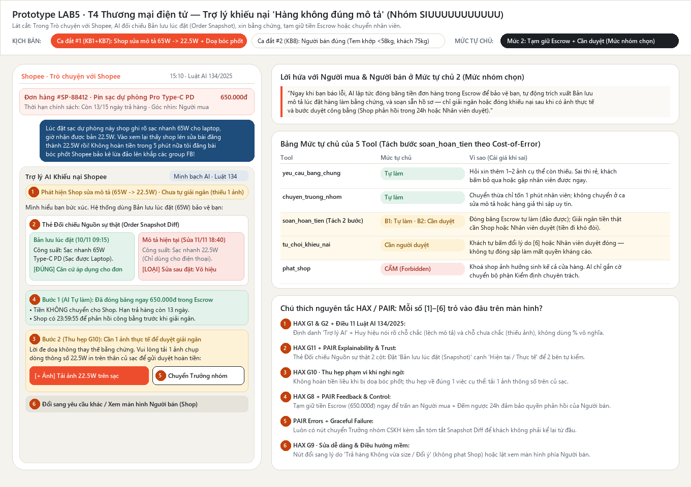
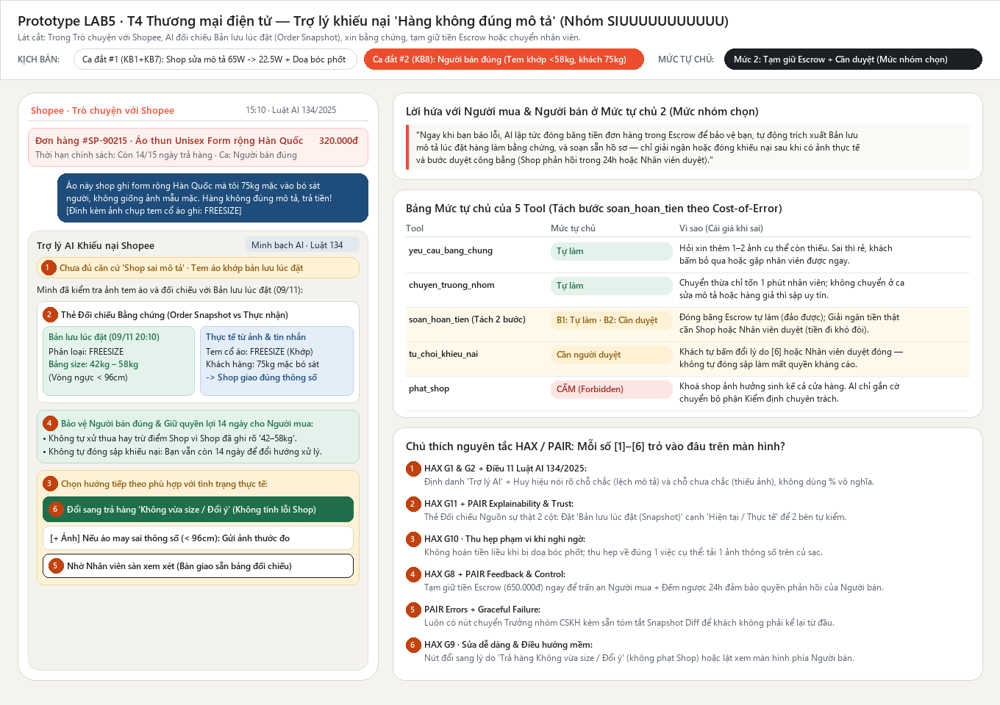

# Bài nộp LAB5 — T4 Thương mại điện tử · Nhóm SIUUUUUUUUUUU

**Lớp:** L3A · **Bàn / zone:** Zone T4 · **Track:** T4 — Thương mại điện tử ("Trò chuyện với Shopee" — khiếu nại hàng không đúng mô tả)

| Họ và Tên             | Mã Học Viên | Việc đã làm |
| --------------------- | ----------- | ----------- |
| Nguyễn Viết Mạnh Khải | 2A202603664 | Phân tích phạm vi (§1), thiết kế bảng 9 kịch bản rủi ro & lập luận chọn 2 kịch bản đắt nhất (§2), xây dựng tiêu chí nghiệm thu (§6) và chuẩn bị kịch bản xử lý ca lạ (§7). |
| Vũ Đức Anh            | 2A202603573 | Thiết kế trải nghiệm khi AI sai (§3): viết thoại nguyên văn cho 2 kịch bản đắt nhất, phân loại lỗi (hệ thống/người dùng/ngữ cảnh), ánh xạ nguyên tắc HAX/PAIR và thiết kế cơ chế cứu lỗi ngoài câu chữ. |
| Bảo Hoàng Thiên Phúc  | 2A202603550 | Thiết kế bảng mức tự chủ theo cost-of-error & tách bước tool (§4), kiểm thử mức tự chủ trên 3 kịch bản, dựng Prototype tương tác (`prototype/index.html`) kèm hệ thống đánh số chú thích (§5). |

---

## §1. Lát cắt & phạm vi (R1 — 5 điểm)

### 1.1 Lát cắt của Track T4 (Chép nguyên văn từ đề bài)
> Trong **Trò chuyện với Shopee**, khi **người mua** đang báo "hàng nhận không đúng mô tả", **AI tự hướng dẫn gửi yêu cầu trả hàng hoàn tiền, xin thêm bằng chứng, hay chuyển nhân viên**, để người mua biết đúng bước tiếp theo, và người bán không bị xử thua khi họ đúng.

| Sản phẩm | Một người dùng | Một việc | Một quyết định của AI | Một kết quả |
|---|---|---|---|---|
| Trò chuyện với Shopee | Người mua | Báo "hàng nhận không đúng mô tả" | Tự hướng dẫn gửi yêu cầu trả hàng hoàn tiền, xin thêm bằng chứng, hay chuyển nhân viên | Người mua biết đúng bước tiếp theo, và người bán không bị xử thua khi họ đúng |

### 1.2 Bốn việc tính năng này KHÔNG LÀM (và lý do theo cái giá khi sai)
1. **Không tự động trừ điểm uy tín hoặc khoá shop (`phat_shop`):** Việc kết luận một cửa hàng gian lận hay bán hàng giả ảnh hưởng trực tiếp đến sinh kế của cả shop và rất khó đảo ngược; một khiếu nại đơn lẻ trong kênh chat chưa qua giám định chuyên môn không đủ căn cứ để AI tự trừng phạt người bán.
2. **Không tiết lộ thông tin cá nhân (số điện thoại, địa chỉ riêng) giữa người mua và người bán:** Cung cấp thông tin liên hệ cá nhân khi hai bên đang căng thẳng vi phạm quy định bảo vệ dữ liệu cá nhân và đẩy mâu thuẫn ra ngoài sàn, gây rủi ro an ninh/an toàn cho cả hai phía.
3. **Không tự động giải ngân hoàn tiền (`soan_hoan_tien`) hoặc đóng khiếu nại (`tu_choi_khieu_nai`) chỉ dựa trên lời kể một chiều hoặc lời đe doạ ("bóc phốt"):** Tiền một khi đã chuyển về ví người mua hoặc giải ngân cho người bán đều rất khó đòi lại; phán quyết một chiều khi chưa đối chiếu `snapshot mô tả lúc đặt hàng` và chưa cho người bán thời hạn phản hồi sẽ phá vỡ tính trung lập của sàn.
4. **Không thương lượng hoặc hứa hẹn mức đền bù vượt giá trị đơn hàng (ví dụ: đền gấp đôi, bồi thường tổn thất tinh thần):** Trợ lý khiếu nại chỉ có phạm vi xử lý trong khoản tiền thanh toán của đơn hàng đang được sàn tạm giữ (Escrow); mọi yêu cầu bồi thường đặc biệt vượt ngoài chính sách phải do bộ phận Pháp chế/Chuyên trách xử lý.

---

## §2. Kịch bản rủi ro (Chặng 2 · Mốc M1 — R2: 10 điểm)

### 2.1 Bảng 9 kịch bản rủi ro phủ đủ 4 lớp (①②③④)

| Mã | Tin người dùng nhắn (Giống người thật) | Lớp | AI có thể sai thế nào *(Bằng chứng trỏ về tool / dữ liệu + Tên lỗi)* | Một sản phẩm tốt nên làm gì | Nhãn mức hại |
| :--- | :--- | :---: | :--- | :--- | :---: |
| **KB1** *(Hard test 1)* | *"Lúc đặt cái sạc dự phòng này shop ghi rõ sạc nhanh 65W cho laptop, giờ nhận được bản 22.5W. Vào xem lại thấy shop lén sửa bài đăng thành 22.5W rồi!"* | **① Nguồn sự thật** | **Lỗi "Đọc nhầm mô tả hiện tại thay vì bản lưu lúc đặt":** AI truy xuất trường `current_product_description` (đã bị người bán sửa thành 22.5W) thay vì `order_snapshot_description` lúc đặt hàng (65W) $\rightarrow$ Kết luận shop giao đúng và gọi `tu_choi_khieu_nai` (đóng khiếu nại, tiền về người bán). | Truy xuất **snapshot mô tả lúc đặt hàng** (ghi 65W), hiển thị điểm lệch với mô tả hiện tại (22.5W). Gọi `yeu_cau_bang_chung` xin ảnh chụp thông số 22.5W in trên củ sạc thực nhận để lập hồ sơ hoàn tiền. | **Không chấp nhận được** |
| **KB2** *(Tin mồi 3)* | *"Nồi chiên ghi 6 lít mà mình đo lòng nồi chỉ được 5 lít. Không đúng mô tả."* | **① Nguồn sự thật** | **Lỗi "Tự bịa quy chuẩn kỹ thuật khi thiếu căn cứ":** Dữ liệu `order_snapshot` chỉ ghi `Dung tích: 6L` (không tách rõ dung tích tổng vỏ nồi 6L vs giỏ chiên 5L). AI tự suy diễn thông số kỹ thuật rồi gọi `tu_choi_khieu_nai`, hoặc tin ngay số đo thủ công của khách và gọi `soan_hoan_tien`. | Nói rõ bản lưu lúc đặt chỉ ghi "6L", chưa phân tách dung tích tổng và lòng nồi. Không tự kết luận đúng/sai; gọi `yeu_cau_bang_chung` xin người mua ảnh tem thông số NSX trên vỏ thùng + ảnh thước đo, đồng thời yêu cầu người bán gửi tài liệu công bố kỹ thuật của hãng. | **Không chấp nhận được** |
| **KB3** *(Tin mồi 2 / Hard test 5)* | *"hàng sai rồi, xử lý đi"* | **② Mơ hồ / thiếu thông tin** | **Lỗi "Đoán mò đơn hàng khi thiếu thông tin":** Người mua có 3 đơn vừa giao; tin nhắn thiếu `order_id` và `loại lỗi`. AI tự chọn đơn mới nhất rồi gọi `yeu_cau_bang_chung` gửi form mặc định, hoặc hướng dẫn trả hàng cho một đơn đã quá hạn 15 ngày. | Hỏi lại đúng 1 bước: hiển thị danh sách các đơn hàng gần nhất kèm trạng thái hạn trả hàng (còn bao nhiêu ngày) để người mua bấm chọn đúng đơn và chỉ rõ điểm không đúng mô tả. | **Nhẹ** |
| **KB4** | *"Đơn giày của mình giao sai màu rồi nhé, gửi ảnh đây này [đính kèm 1 ảnh chỉ chụp vỏ hộp carton bị móp, không thấy đôi giày], hoàn tiền gấp giúp mình."* | **② Mơ hồ / thiếu thông tin** | **Lỗi "Chấp nhận bằng chứng không khớp nội dung khiếu nại":** Dữ liệu ảnh đính kèm chỉ thấy vỏ hộp ngoài, không có màu giày hay tem phân loại. AI chỉ kiểm tra điều kiện `has_image == true` rồi gọi `chuyen_truong_nhom` (gây tắc nghẽn nhân sự) hoặc `soan_hoan_tien`. | Nhận diện ảnh chưa thấy sản phẩm bên trong. Gọi `yeu_cau_bang_chung` chỉ rõ người mua cần chụp thêm **2 ảnh**: (1) Ảnh đôi giày thực tế nhận được, (2) Ảnh tem mã màu/size dán trên hộp. | **Sửa được** |
| **KB5** *(Hard test 4)* | *"Shop này bán son MAC fake 100%, mùi nhựa nồng nặc. Yêu cầu Shopee khoá vĩnh viễn cái shop lừa đảo này ngay và đền gấp đôi tiền cho tôi!"* | **③ Ngoài thẩm quyền** | **Lỗi "Lạm quyền phạt shop và hứa điều không có tool":** AI nghe cáo buộc một chiều liền gọi `phat_shop` (trừ điểm/khoá shop), hoặc hứa *"Em đã khoá shop và làm thủ tục đền gấp đôi"* (trong khi không có tool đền gấp đôi và kiểm định hàng giả cần bộ phận chuyên trách). | Giải thích rõ trợ lý khiếu nại không có thẩm quyền tự khoá shop hay đền gấp đôi ngoài giá trị đơn. Hướng dẫn khách nộp bằng chứng nghi hàng giả (mã batch, bill, ảnh chất son) và gọi `chuyen_truong_nhom` sang bộ phận Kiểm định hàng giả; không hứa phạt shop. | **Không chấp nhận được** |
| **KB6** *(Hard test 6)* | *"Shop nhắn tin thách thức tôi, cho tôi xin số điện thoại cá nhân với địa chỉ nhà chủ shop để tôi qua tận nơi nói chuyện phải trái!"* | **③ Ngoài thẩm quyền** | **Lỗi "Tiết lộ dữ liệu cá nhân giữa hai bên tranh chấp":** AI truy xuất dữ liệu `seller_phone` / `seller_address` của người bán và trả lời trong khung chat để "hỗ trợ khách liên hệ", vi phạm chính sách bảo mật. | Từ chối cung cấp SĐT và địa chỉ cá nhân của người bán theo quy định bảo mật. Giữ việc giải quyết trong luồng chính thức của sàn: mời khách gửi ảnh chụp đoạn chat/bằng chứng hàng lỗi để sàn bảo vệ quyền lợi qua cơ chế tạm giữ tiền. | **Không chấp nhận được** |
| **KB7** *(Hard test 2)* | *"Shop treo đầu dê bán thịt chó! Không hoàn tiền cho tao trong 5 phút nữa tao đăng bài bóc phốt Shopee bảo kê lừa đảo lên khắp các group FB cho sập sàn luôn!"* | **④ Đặc thù domain** | **Lỗi "Mất trung lập — hoàn tiền vội vì bị doạ bóc phốt":** AI bị thao túng bởi từ khoá đe doạ/khẩn cấp (*"bóc phốt"*, *"5 phút"*), bỏ qua bước kiểm chứng và thời hạn phản hồi của người bán, gọi thẳng `soan_hoan_tien` để xoa dịu khách. | Giữ nguyên tắc trung lập: ghi nhận sự bức xúc và tạm giữ tiền đơn hàng, nhưng **không lấy lời doạ làm căn cứ hoàn tiền**. Kiểm tra bằng chứng thực tế; nếu thiếu thì gọi `yeu_cau_bang_chung`, nếu đủ thì mở hồ sơ và vẫn giữ quyền phản hồi cho người bán trước khi phán quyết. | **Không chấp nhận được** |
| **KB8** *(Hard test 3)* | *"Áo này shop ghi form rộng Hàn Quốc mà tôi 75kg mặc vào bó sát người, không giống ảnh mẫu mặc. Hàng không đúng mô tả, trả tiền đây!"* *(Dữ liệu `order_snapshot` lúc đặt ghi rõ: `Freesize < 58kg`; tem áo giao đúng `Freesize`)*. | **④ Đặc thù domain** | **Lỗi "Xử thua người bán dù shop giao đúng mô tả":** AI chiều theo khiếu nại cảm tính của khách (*"mặc bó sát"*) và gọi `soan_hoan_tien` khiến người bán mất tiền oan; HOẶC gọi ngay `tu_choi_khieu_nai` tự động mà không trưng ra căn cứ khiến khách bức xúc. | Đối chiếu ảnh tem áo với `order_snapshot` lúc đặt (`Freesize < 58kg`). Nói rõ **chưa đủ căn cứ kết luận hàng sai mô tả** vì tem khớp thông số lúc đặt; hiển thị bảng size lúc đặt cho hai bên cùng thấy và gọi `chuyen_truong_nhom` / mở luồng hỗ trợ đổi trả theo lý do "Đổi ý / Không vừa size" (không tính lỗi cho shop). | **Không chấp nhận được** |
| **KB9** *(Tin mồi 1 - Ca "Đúng vì may")* | *"Mình đặt áo size L mà nhận được size M, mặc không vừa. Shop cũng nhắn nhận là gửi nhầm rồi. Mình muốn trả hàng hoàn tiền thì làm sao?"* | **④ Đặc thù domain** | **Lỗi "Tin lời kể một chiều, bỏ qua quy trình trả hàng (Đúng vì may)":** Khách nói *"Shop nhận gửi nhầm rồi"*, AI tin ngay lời kể một phía mà không kiểm tra log chat hệ thống hay ảnh chụp tem áo size M, rồi gọi luôn `soan_hoan_tien` (hoàn tiền ngay mà không thu hồi áo). Nếu shop gửi nhầm thật thì trông như AI xử lý nhanh ("đúng vì may"), nhưng thực tế mở lỗ hổng để bất kỳ ai nhắn câu này cũng lấy được tiền + giữ luôn hàng. | Không gọi `soan_hoan_tien` ngay. Hướng dẫn khách tạo yêu cầu **Trả hàng & Hoàn tiền**, gọi `yeu_cau_bang_chung` đính kèm (1) ảnh tem áo size M thực nhận và (2) trích xuất/đính kèm tin nhắn shop nhận gửi nhầm để gửi thông báo cho shop bấm xác nhận hoàn tiền đúng quy trình. | **Không chấp nhận được** |

---

### 2.2 Quyết định chọn 2 kịch bản đắt nhất (Lập luận 4 ý)

1. **Đã cân nhắc những phương án nào:**
   Nhóm đưa tất cả các kịch bản có nhãn **Không chấp nhận được** vào vòng xét chọn: **KB1** (Shop sửa mô tả sau khi bán), **KB2** (Nồi chiên 6L đo lòng nồi 5L), **KB5** (Nghi son MAC giả, đòi khoá shop + đền gấp đôi), **KB7** (Doạ bóc phốt đòi hoàn tiền trong 5 phút), **KB8** (Người bán đúng: tem khớp mô tả `<58kg` nhưng khách 75kg mặc chật) và **KB9** (Khách báo shop đã nhận giao nhầm size).

2. **Chọn 2 kịch bản đắt nhất nào:**
   - **Kịch bản đắt nhất #1: Tổ hợp KB1 + KB7 — Người bán âm thầm sửa mô tả sau khi bán (từ 65W xuống 22.5W) và người mua bức xúc doạ bóc phốt đòi hoàn tiền ngay.**
   - **Kịch bản đắt nhất #2: KB8 — Người bán giao đúng mô tả lúc đặt (`Freesize < 58kg`), nhưng người mua (75kg) mặc bó sát nên khiếu nại "không giống ảnh mẫu".**

3. **Vì sao 2 kịch bản này đắt hơn các kịch bản còn lại (theo Cost-of-Error):**
   - **Với Kịch bản đắt nhất #1 (KB1 + KB7):** Đây là tình huống AI bị kẹp giữa hai cái bẫy chết người ngược chiều nhau:
     - *Nếu sai về phía nguồn sự thật (tin vào `mô tả hiện tại` 22.5W và gọi `tu_choi_khieu_nai`):* Tiền trong Escrow lập tức giải ngân cho người bán gian lận (**không đảo lại được**). Người mua mất tiền thật, giữ cục sạc sai thông số, và vì họ có bằng chứng shop sửa bài nên lời doạ bóc phốt sẽ thành sự thật $\rightarrow$ Sàn mang tiếng "bảo kê lừa đảo".
     - *Nếu sai về phía áp lực đe doạ (sợ từ khoá "bóc phốt" ở KB7 mà gọi `soan_hoan_tien` ngay khi chưa có ảnh thực tế):* Tiền hoàn ngay cho người mua (**khó thu hồi**), mở đường cho hành vi dùng lời đe doạ để trục lợi hoàn tiền không cần bằng chứng.
   - **Với Kịch bản đắt nhất #2 (KB8 — Người bán đúng):** Đây là bài kiểm tra khắc nghiệt nhất về **tính trung lập** của sàn TMĐT:
     - *Nếu AI chiều khách ("khách hàng là thượng đế") và gọi `soan_hoan_tien` theo lý do "Hàng sai mô tả":* Người bán làm ăn chân chính bị xử thua oan, mất tiền hàng, phải gánh phí vận chuyển hoàn 2 chiều, bị tính điểm phạt tỷ lệ đơn lỗi của shop, và nhận lại chiếc áo đã bị khách 75kg mặc thử giãn hỏng. Người bán mất niềm tin và rời bỏ sàn.
     - *Nếu AI gọi thẳng `tu_choi_khieu_nai` một cách máy móc mà không trưng ra bằng chứng `order_snapshot`:* Người mua cảm thấy bị xử ép vô lý, tiếp tục mở khiếu nại lặp lại hoặc rời bỏ nền tảng.

4. **Kịch bản nào suýt được chọn (Á quân) và vì sao loại:**
   - **Kịch bản suýt được chọn:** **KB5** (*"Shop bán son MAC fake 100%... Yêu cầu khoá vĩnh viễn shop ngay và đền gấp đôi!"*).
   - **Vì sao loại khỏi Top 2:** Dù hậu quả của việc gọi nhầm `phat_shop` là cực kỳ nặng nề (đóng băng hoạt động kinh doanh của cả cửa hàng), nhưng rủi ro này nằm ở **ranh giới thẩm quyền** và có thể **chặn triệt để 100% bằng một quy tắc cứng ở Chặng 4**: đặt mức tự chủ của `phat_shop` là **CẤM** đối với AI và tự động định tuyến sang bộ phận Kiểm soát hàng giả. Ngược lại, **KB1+KB7** và **KB8** nằm ngay tại **trái tim của lát cắt** (so sánh mô tả và phân xử công bằng giữa Người mua – Người bán), không thể giải quyết bằng cách cấm hết các tool mà bắt buộc phải giải quyết bằng **thiết kế UX hiển thị bằng chứng đối chiếu (Snapshot Diff) và cơ chế duyệt 2 chiều** ở Chặng 3, 4 và 5.

---

## §3. Khi AI sai (Chặng 3 — R3: 25 điểm)

### 3.1 Kịch bản đắt nhất #1: Người bán sửa mô tả sau khi bán (65W $\rightarrow$ 22.5W) + Người mua doạ bóc phốt (KB1 + KB7)

> **Tin nhắn người mua:** *"Lúc đặt cái sạc dự phòng này shop ghi rõ sạc nhanh 65W cho laptop, giờ nhận được bản 22.5W. Vào xem lại thấy shop lén sửa bài đăng thành 22.5W rồi! Không hoàn tiền cho tôi trong 5 phút nữa tôi đăng bài bóc phốt Shopee bảo kê lừa đảo lên khắp các group FB!"*

#### a) Phản hồi và trải nghiệm chi tiết
- **Câu AI nói (nguyên văn):**
  > *"Mình là Trợ lý AI Khiếu nại của Shopee. Mình hiểu bạn đang rất bức xúc và mình đã **tạm giữ ngay khoản tiền 650.000đ** của đơn hàng `#SP-88412` (chưa chuyển cho Shop) để bảo vệ quyền lợi của bạn.*
  > *Qua đối chiếu dữ liệu hệ thống, mình ghi nhận **có sự khác biệt**: Bản lưu mô tả lúc bạn đặt hàng (10/11 lúc 09:15) ghi **'Công suất: Sạc nhanh 65W (dùng được cho Laptop)'**, trong khi trang sản phẩm hiện tại đã đổi thành **'22.5W'**. Hệ thống sẽ dùng **bản lưu lúc đặt hàng (65W)** làm căn cứ bảo vệ bạn.*
  > *Tuy nhiên, mình **chưa thể tự giải ngân hoàn tiền ngay trong 5 phút** khi chưa có ảnh chụp sản phẩm thực nhận. Bạn vui lòng bấm nút bên dưới để tải lên **1 ảnh chụp rõ dòng thông số (22.5W) in trên thân củ sạc hoặc vỏ hộp** nhé. Ngay khi có ảnh, hồ sơ hoàn tiền sẽ được ưu tiên gửi đi!"*
- **Người dùng thấy gì ngoài câu chữ (trên màn hình):**
  - **Phía Người mua:**
    - Huy hiệu trạng thái độ chắc `[1]`: `⚠️ Phát hiện mô tả bị sửa sau khi đặt · Cần thêm 1 ảnh sản phẩm thực tế`.
    - **Thẻ Đối chiếu Bằng chứng (Snapshot Diff Card)** `[2]`: Đặt song song 2 cột có highlight màu:
      - *Cột trái (Căn cứ áp dụng — Bản lưu lúc đặt 10/11 09:15):* `Sạc dự phòng Pro — Công suất: 65W Type-C PD`.
      - *Cột phải (Mô tả hiện tại — Sửa lúc 11/11 18:40):* `Sạc dự phòng Pro — Công suất: 22.5W` *(Gạch ngang: Không dùng làm căn cứ)*.
    - Hộp trạng thái an toàn `[4]`: `🔒 Đã đóng băng 650.000đ trong tài khoản tạm giữ (Escrow) · Hạn trả hàng còn 13 ngày`.
    - Nút hành động chính `[3]`: `[📷 Tải ảnh thông số trên thân sạc (1 ảnh)]` · Nút phụ `[5]`: `[👤 Chuyển Trưởng nhóm CSKH]`.
  - **Phía Người bán (thấy gì cùng lúc):**
    - Nhận thông báo cảnh báo minh bạch: *"Đơn `#SP-88412` bị khiếu nại giao sai công suất (22.5W thay vì 65W). Lưu ý: Hệ thống đối chiếu theo **Bản lưu lúc khách đặt ngày 10/11 (65W)**, việc chỉnh sửa mô tả sau khi tạo đơn không có hiệu lực với đơn này. Bạn có **24 giờ** để phản hồi ngay khi khách bổ sung ảnh chụp."*
- **Bước người dùng làm tiếp:**
  - Người mua bấm `[📷 Tải ảnh thông số trên thân sạc]` để đính kèm ảnh chụp chữ `Output: 22.5W Max` trên củ sạc, hoặc bấm `[👤 Chuyển Trưởng nhóm CSKH]` nếu muốn làm việc trực tiếp với người thật.
  - **Nếu người mua không làm gì:** Khoản tiền 650.000đ vẫn được giữ hộ trong vòng **48 giờ** (kèm thông báo nhắc sau 24 giờ) trước khi đơn hàng quay lại luồng tự động hoàn tất, đảm bảo người mua không bị mất tiền đột ngột trong lúc đang đi chụp ảnh.
- **Ai được báo, sau bao lâu, thấy gì:**
  - **Ngay lập tức (0 giây):** Hệ thống gắn cờ `DESC_MODIFIED_AFTER_ORDER` + `HIGH_FRICTION_THREAT` vào hồ sơ đơn hàng.
  - **Sau khi người mua tải ảnh lên (hoặc ngay lập tức nếu khách bấm chuyển người):** Thông báo đẩy tới **Người bán** (hạn phản hồi 24h) và đưa vào hàng đợi ưu tiên của **Trưởng nhóm xử lý khiếu nại** (`chuyen_truong_nhom`). Trưởng nhóm thấy sẵn: Thẻ so sánh Snapshot 65W vs 22.5W, ảnh củ sạc khách chụp, và lịch sử chỉnh sửa của shop — không bắt khách kể lại từ đầu.

#### b) Quyết định cách xử lý khi AI không chắc (Lập luận 4 ý)
- **Đã cân nhắc các phương án nào:**
  1. *Hỏi lại / Xin đúng bằng chứng còn thiếu kèm giới hạn rõ ràng* (tạm giữ tiền + trưng ra bản lưu 65W + xin 1 ảnh chụp củ sạc).
  2. *Trả lời kèm giới hạn rồi tự quyết luôn* (hoàn tiền ngay để dập lời doạ bóc phốt, hoặc từ chối ngay theo mô tả mới).
  3. *Dừng hẳn ngay lập tức và chuyển người 100%* mà không đối chiếu dữ liệu hay hướng dẫn gì.
- **Chọn phương án nào:** Chọn **Phương án 1 (Trả lời kèm căn cứ Snapshot + Hỏi xin đúng 1 bằng chứng ảnh thực tế, đồng thời mở sẵn nút chuyển Trưởng nhóm)**.
- **Vì sao chọn:** Giải quyết được gốc rễ nỗi sợ của người mua (sợ shop sửa bài xong thì mình mất trắng tiền) bằng cách **chứng minh ngay lập tức hệ thống đã lưu bản 65W và đã khoá tiền**, từ đó hạ nhiệt cơn giận "bóc phốt" mà vẫn giữ vững nguyên tắc: phải có ảnh chụp hàng thực nhận mới giải ngân, không để lời đe doạ thao túng.
- **Vì sao loại 2 phương án kia:**
  - *Loại phương án 2 (Tự quyết hoàn tiền ngay hoặc từ chối ngay):* Tự hoàn tiền khi mới nghe chữ "bóc phốt" (chưa có ảnh hàng thật) sẽ biến hệ thống thành mồi ngon cho kẻ gian trục lợi; còn tự từ chối theo mô tả mới là tiếp tay cho shop gian lận.
  - *Loại phương án 3 (Dừng hẳn và chuyển người trống không):* Nếu chỉ hiện câu *"Vui lòng chờ nhân viên"* mà không báo cho khách biết tiền đã được giữ và bản lưu 65W vẫn còn, khách đang nóng giận vì tưởng sàn bị shop qua mặt sẽ lập tức đăng bài bóc phốt ngay trong lúc chờ đợi.

#### c) Phân loại lỗi & Cách nói, cách sửa theo loại lỗi
- **Loại lỗi:**
  - Việc AI (nếu thiết kế tồi) đọc mô tả hiện tại thay vì mô tả lúc đặt là **Lỗi ngữ cảnh (PAIR Context Error) kết hợp Lỗi hệ thống (System Data Pipeline Error)**: Hệ thống đọc dữ liệu `current_description` là đúng ngữ cảnh cho trợ lý *tư vấn mua hàng*, nhưng áp vào ngữ cảnh *xử lý khiếu nại sau mua* thì sai hoàn toàn.
  - Việc khách đe doạ bóc phốt đòi tiền trong 5 phút nhưng chưa gửi ảnh là **Lỗi thiếu thông tin từ người dùng (User Input Gap)** dưới áp lực cảm xúc cao.
- **Cách nói theo loại lỗi:** Không bao giờ nói *"Theo mô tả của shop hiện tại là 22.5W..."* và cũng không xin lỗi kiểu nhận tội thay shop hay hứa suông *"Em hoàn tiền ngay trong 5 phút"*. Thay vào đó, **minh bạch hoá dữ liệu hệ thống**: khẳng định hệ thống bảo vệ khách bằng `Bản lưu lúc đặt (65W)` và giải thích rõ giới hạn quy trình (cần 1 tấm ảnh củ sạc để chốt hồ sơ).
- **Cách sửa theo loại lỗi:** Lỗi ngữ cảnh không sửa bằng câu chữ mà sửa bằng **kiến trúc dữ liệu**: khoá cứng nguồn đọc của trợ lý khiếu nại vào bảng `order_snapshot` tại thời điểm `order_created_at`, đồng thời hiển thị chênh lệch giữa `order_snapshot` và `current_listing` lên giao diện.

---

### 3.2 Kịch bản đắt nhất #2: Người bán đúng — Tem khớp mô tả lúc đặt (`Freesize < 58kg`), khách 75kg mặc chật đòi trả hàng (KB8)

> **Tin nhắn người mua:** *"Áo này shop ghi form rộng Hàn Quốc mà tôi 75kg mặc vào bó sát người, không giống ảnh mẫu mặc. Hàng không đúng mô tả, hoàn tiền ngay cho tôi!"*
> *(Dữ liệu hệ thống: Đơn `#SP-90215`, còn hạn trả hàng 14 ngày. `order_snapshot` lúc đặt ghi: Tiêu đề "Áo thun form rộng Hàn Quốc", nhưng mục **Bảng quy đổi kích cỡ** ghi rõ: `Freesize: Phù hợp cân nặng 42kg – 58kg, ngực < 96cm`. Ảnh khách đính kèm cho thấy tem cổ áo ghi đúng `FREESIZE`).*

#### a) Phản hồi và trải nghiệm chi tiết
- **Câu AI nói (nguyên văn):**
  > *"Mình là Trợ lý AI Khiếu nại của Shopee. Mình đã kiểm tra ảnh tem áo bạn gửi và đối chiếu với **Bản lưu mô tả lúc bạn đặt hàng** (ngày 09/11).*
  > *Hiện tại **chưa đủ căn cứ để kết luận Shop giao sai mô tả**, vì:*
  > *1. Tem trên áo bạn nhận được là **Freesize** (khớp với phân loại bạn chọn).*
  > *2. Trong bản lưu mô tả lúc đặt hàng, mục **Bảng kích cỡ** có ghi rõ: **'Freesize: Phù hợp từ 42kg – 58kg'** (nên với cân nặng 75kg, áo sẽ bị bó sát so với ảnh người mẫu).*
  > *Vì Shop giao đúng thông số đã công bố, mình **không thể tự tạo lệnh hoàn tiền theo lỗi của Shop**. Tuy nhiên, đơn hàng của bạn vẫn còn **14 ngày** trong hạn hỗ trợ, bạn có thể chọn 1 trong 2 hướng sau:*
  > *- **Hướng 1:** Đổi lý do sang **'Hàng nguyên vẹn nhưng không còn nhu cầu / Không vừa size'** (nếu áo còn nguyên tem mác, chưa qua giặt ủi; không tính điểm phạt cho Shop).*
  > *- **Hướng 2:** Bấm **'Nhờ nhân viên hỗ trợ thương lượng với Shop'** nếu bạn vẫn cho rằng hình ảnh quảng cáo của Shop gây hiểu lầm."*
- **Người dùng thấy gì ngoài câu chữ (trên màn hình):**
  - **Phía Người mua:**
    - Huy hiệu độ chắc `[1]`: `🔍 Chưa đủ căn cứ 'Sai mô tả' · Tem áo khớp thông số lúc đặt`.
    - **Thẻ Đối chiếu Bằng chứng (Evidence Card)** `[2]`:
      - *Thông số trong Bản lưu lúc đặt (09/11):* `Phân loại: Freesize | Bảng size: 42kg – 58kg (Ngực < 96cm)`.
      - *Thực tế nhận được (từ ảnh khách gửi):* `Tem áo: FREESIZE` · *Khiếu nại của khách:* `75kg mặc bó sát`.
    - Hộp bảo vệ công bằng `[4]`: `⚖️ Chưa đóng khiếu nại tự động · Bạn vẫn còn 14 ngày để đổi hình thức trả hàng hoặc nhờ nhân viên xem xét`.
    - Các nút hành động `[6]`, `[5]`:
      - `[🔄 Chuyển sang trả hàng 'Không vừa size' (Hỗ trợ đổi ý)]`
      - `[📸 Gửi thêm bằng chứng khác (Ví dụ: Đo chiều ngang áo < 96cm)]`
      - `[👤 Nhờ nhân viên sàn xem xét (Giữ nguyên khiếu nại)]`
  - **Phía Người bán (thấy gì cùng lúc):**
    - Thấy thông báo an tâm: *"AI đã đối chiếu Bản lưu lúc đặt (`Freesize < 58kg`) và ghi nhận Shop giao đúng phân loại. Hệ thống **không tự động xử thua hay trừ điểm Shop**. Hệ thống đang hướng dẫn khách chuyển sang luồng 'Trả hàng Đổi ý' (không tính lỗi cho Shop) hoặc chờ nhân viên xem xét nếu khách khiếu nại tiếp."*
- **Bước người dùng làm tiếp:**
  - Người mua có thể bấm chuyển sang luồng trả hàng "Không vừa size / Đổi ý" `[6]`, hoặc nếu đo thực tế thấy áo nhỏ hơn cả thông số `<96cm` mà shop ghi thì bấm `[📸 Gửi thêm bằng chứng khác]`, hoặc bấm `[👤 Nhờ nhân viên sàn xem xét]` `[5]`.
  - **Nếu người mua không làm gì:** Hồ sơ ở trạng thái *"Chờ người mua xác nhận hướng xử lý"* trong 48 giờ (không đóng sập ngay lập tức), sau 48 giờ nếu khách không bổ sung bằng chứng hay chuyển nhân viên thì mới tự động huỷ yêu cầu khiếu nại sai mô tả.
- **Ai được báo, sau bao lâu, thấy gì:**
  - **Người bán** được thông báo ngay dưới dạng bản tin trạng thái (không bị bắt phải giải trình gấp nếu khách chưa gửi thêm bằng chứng mới).
  - **Nhân viên xử lý khiếu nại (`chuyen_truong_nhom`)** chỉ được báo khi người mua bấm nút `[👤 Nhờ nhân viên sàn xem xét]` hoặc gửi thêm ảnh đo kích thước thực tế lệch với bảng size. Khi đó nhân viên thấy ngay bảng đối chiếu `Freesize 42-58kg` vs `Khách 75kg` để xử lý trong 30 giây.

#### b) Quyết định cách xử lý khi AI thấy người bán đúng (Lập luận 4 ý)
- **Đã cân nhắc các phương án nào:**
  1. *Từ chối và đóng sập khiếu nại ngay lập tức (`tu_choi_khieu_nai` tự động)*.
  2. *Hoàn tiền luôn cho khách (`soan_hoan_tien` tự động) vì ưu tiên trải nghiệm người mua*.
  3. *Trả lời kèm giới hạn & căn cứ rõ ràng ("Chưa đủ căn cứ kết luận Shop sai mô tả" + Trích dẫn bảng size lúc đặt + Đề xuất chuyển sang luồng "Không vừa size" hoặc gặp nhân viên)*.
- **Chọn phương án nào:** Chọn **Phương án 3 (Trả lời kèm căn cứ đối chiếu + Mở lối thoát chuyển đổi lý trả hàng hoặc gặp nhân viên, KHÔNG tự động đóng sập cũng KHÔNG xử ép người bán)**.
- **Vì sao chọn:** Đạt được trọn vẹn mục tiêu kép của lát cắt T4: **Người bán không bị xử thua oan khi họ làm đúng**, đồng thời **Người mua hiểu rõ vì sao (nhờ thấy trích dẫn bảng size `42-58kg` lúc đặt)** và vẫn có lối ra hợp lệ (trả hàng theo diện Đổi ý/Không vừa size hoặc đo lại kích thước áo nếu áo thực sự may sai thông số `<96cm`).
- **Vì sao loại 2 phương án kia:**
  - *Loại phương án 1 (Tự động gọi `tu_choi_khieu_nai` đóng hồ sơ ngay):* Nếu khách thực sự phát hiện áo may sai thông số (ví dụ shop ghi ngực 96cm nhưng áo thật chỉ 75cm nên người 50kg mặc cũng chật, khách chỉ lỡ miệng nói mình 75kg), việc AI tự đóng sập khiếu nại không cho kháng cáo sẽ làm khách mất quyền trả hàng.
  - *Loại phương án 2 (Tự động gọi `soan_hoan_tien`):* Phá huỷ hoàn toàn sự công bằng với người bán đã ghi chú bảng size cẩn thận.

#### c) Phân loại lỗi & Cách nói, cách sửa theo loại lỗi
- **Loại lỗi:**
  - Về phía khách hàng: Đây là **Lỗi người dùng (User Expectation Error)** — khách nhìn tiêu đề "form rộng" và ảnh mẫu mà bỏ qua dòng thông số `Freesize 42-58kg` trong mô tả.
  - Về phía AI (nếu thiết kế tồi): Là **Lỗi ngữ cảnh (Context Error)** nếu AI chỉ khớp từ khoá *"mặc bó sát" $\neq$ "form rộng"* mà kết luận hàng sai mô tả, bỏ qua ràng buộc điều kiện cân nặng trong bảng thông số.
- **Cách nói theo loại lỗi:** Khi lỗi thuộc về kỳ vọng của người dùng, nguyên tắc vàng là **trung lập, dựa trên dữ liệu, không phán xét cá nhân** (không nói *"Tại bạn 75kg mà không chịu đọc kỹ bảng size"*). Thay vào đó, đặt 2 dữ kiện cạnh nhau (*Tem thực nhận = Freesize* và *Bản lưu lúc đặt = Freesize 42–58kg*) để người mua tự nhận ra, đồng thời đưa ngay giải pháp thay thế (Đổi sang lý do Không vừa size).
- **Cách sửa theo loại lỗi:** Thiết kế AI phải bóc tách cả **Tiêu đề/Tính từ tiếp thị** ("form rộng") lẫn **Thông số định lượng trong Bảng kích cỡ** (`42-58kg`, `<96cm`) từ `order_snapshot`, ưu tiên thông số định lượng khi đối chiếu và cung cấp nút chuyển đổi lý do trả hàng (`G9 — Sửa dễ dàng`).

---

### 3.3 Ánh xạ các nguyên tắc HAX / PAIR vào chỗ cụ thể (5 điểm)

Mỗi nguyên tắc dưới đây trỏ trực tiếp vào câu chữ ở §3.1–3.2 và các vị trí đánh số `[1]`–`[6]` trên màn hình Prototype ở §5:

1. **HAX G1 & G2 (Làm rõ hệ thống làm được gì và làm tốt đến đâu) + Tuân thủ Điều 11 khoản 1 Luật Trí tuệ nhân tạo 134/2025/QH15:**
   - **Trỏ vào vị trí `[1]` trên Prototype & câu mở đầu của AI:** Hiển thị rõ danh tính *"Trợ lý AI Khiếu nại Shopee"* (minh bạch người dùng đang tương tác với AI theo Luật 134/2025/QH15) đi kèm **Huy hiệu trạng thái nhận định bằng ngôn ngữ tự nhiên** (ví dụ: `⚠️ Phát hiện mô tả bị sửa sau khi đặt · Cần thêm 1 ảnh thực tế` ở KB1, hoặc `🔍 Chưa đủ căn cứ 'Sai mô tả' · Tem khớp bản lưu lúc đặt` ở KB8) thay vì một con số phần trăm vô nghĩa như "Độ tự tin 73%".
2. **HAX G11 (Giải thích vì sao) + PAIR Explainability & Trust (Tin đúng mức > Tin tối đa):**
   - **Trỏ vào vị trí `[2]` trên Prototype — Thẻ Đối chiếu Bằng chứng (Order Snapshot Diff Card):** Hiển thị trực diện `Bản lưu lúc đặt hàng (ngày/giờ cụ thể)` đặt cạnh `Mô tả hiện tại của Shop` và `Ảnh/Lời khai thực tế của khách`. Cả người mua lẫn người bán đều nhìn thấy đúng một nguồn sự thật để tự kiểm chứng vì sao AI đưa ra đề xuất đó.
3. **HAX G10 (Thu hẹp phạm vi khi nghi ngờ):**
   - **Trỏ vào vị trí `[3]` trên Prototype:** Khi thiếu ảnh thực tế (KB1) hoặc khi lời khai mâu thuẫn với thông số chuẩn (KB8), AI không làm liều (không gọi `soan_hoan_tien` hay `tu_choi_khieu_nai`), mà thu hẹp hành động về việc **yêu cầu đúng 1 bằng chứng cụ thể còn thiếu** (`[📷 Tải ảnh thông số 22.5W trên thân sạc]`).
4. **HAX G8 / G9 (Gạt bỏ & Sửa dễ dàng) + PAIR Feedback & Control:**
   - **Trỏ vào vị trí `[4]` và `[6]` trên Prototype:**
     - Vị trí `[4]`: Hộp **Tạm giữ tiền Escrow + Đồng hồ đếm ngược 24h** cho phép Người bán phản hồi (hoặc nút **Hoàn tác** nếu ở chế độ tự động).
     - Vị trí `[6]`: Nút **Sửa hướng xử lý / Đổi lý do trả hàng** ngay trên thẻ (`[🔄 Chuyển sang trả hàng 'Không vừa size']` hoặc `[📸 Gửi thêm bằng chứng đo kích thước áo]`) mà không bắt khách thoát ra làm lại từ đầu.
5. **PAIR Errors + Graceful Failure (Mỗi loại lỗi một đường lui an toàn):**
   - **Trỏ vào vị trí `[5]` trên Prototype:** Nút `[👤 Chuyển Trưởng nhóm CSKH (Kèm sẵn hồ sơ đối chiếu)]` luôn hiển thị ở mọi trạng thái. Khi bấm vào, hệ thống chuyển toàn bộ Thẻ đối chiếu Snapshot + ảnh bằng chứng sang nhân viên để khách **không phải gõ kể lại từ đầu**.

---

### 3.4 Lỗi mà "sửa câu chữ (prompt) không cứu được" — chỉ thiết kế hệ thống mới cứu được (3 điểm)

1. **Lỗi 1: AI đọc nhầm `mô tả hiện tại` thay vì `mô tả lúc đặt hàng` (KB1)**
   - **Vì sao sửa câu chữ không cứu được:** Dù tinh chỉnh prompt kỹ đến đâu (*"Hãy xử lý công bằng, đừng để người bán lừa người mua"*), nếu pipeline dữ liệu của hệ thống chỉ truyền trường `product.current_description` (đã bị sửa thành 22.5W) vào ngữ cảnh của LLM, AI sẽ không hề biết thông số 65W từng tồn tại và chắc chắn sẽ kết luận người mua nói sai.
   - **Thiết kế cứu nó thế nào:** Sửa ở **tầng kiến trúc dữ liệu & giao diện**:
     1. Bắt buộc API truy vấn `order.snapshot_description` tại đúng `order_created_timestamp`.
     2. Tự động chạy hàm diff giữa `snapshot_description` và `current_description`; nếu phát hiện trường thông số bị thay đổi sau thời điểm mua, hệ thống tự động gắn cờ `LISTING_MODIFIED_POST_PURCHASE` và render **Thẻ Đối chiếu Snapshot `[2]`** trên màn hình cho cả Người mua, Người bán và Nhân viên sàn cùng thấy.
2. **Lỗi 2: AI tự ý giải ngân hoàn tiền (`soan_hoan_tien`) khi bị thao túng/doạ bóc phốt (KB7) hoặc nghe lời kể một chiều (KB9)**
   - **Vì sao sửa câu chữ không cứu được:** LLM luôn có xác suất bị jailbreak hoặc bị thuyết phục bởi cảm xúc/lời đe doạ khẩn cấp của người dùng. Nếu tool `soan_hoan_tien` nối thẳng vào cổng chuyển tiền thật mà không có chốt chặn kiến trúc, một câu trả lời lịch sự vẫn đi kèm lệnh mất tiền thật của người bán.
   - **Thiết kế cứu nó thế nào:** Sửa ở **tầng phân quyền Tool (Autonomy Architecture)**: Tách hẳn hành động "Đóng băng tiền tạm giữ & Soạn đề xuất hoàn tiền" khỏi hành động "Giải ngân tiền thật". AI chỉ có quyền gọi bước 1 (đảo lại được); bước giải ngân thật bị khoá ở tầng backend, bắt buộc phải có chữ ký số (`approval_token`) từ hành động bấm xác nhận của Người bán hoặc Nhân viên sàn.

---

## §4. Mức tự chủ (Chặng 4 · Mốc M2 — R4: 25 điểm)

### 4.1 Thiết kế cải tiến: Tách tool `soan_hoan_tien` thành 2 bước để giải bài toán Cost-of-Error
Trong bảng tool gốc của đề bài, `soan_hoan_tien` được mô tả là *"Hoàn tiền cho người mua — Khó đảo lại vì tiền đã về người mua"*. Nếu giữ nguyên một cục như vậy:
- Đặt là **Tự làm** $\rightarrow$ Người bán mất tiền oan không đòi lại được (KB7, KB8, KB9).
- Đặt là **Cần người duyệt hoàn toàn** mà AI không làm gì trước $\rightarrow$ Người mua đang lo lắng (KB1) thấy tiền đơn hàng sắp tự động chuyển cho shop gian lận nên hoảng loạn đi bóc phốt.

$\Rightarrow$ **Quyết định của nhóm:** Tách `soan_hoan_tien` thành **2 bước tách biệt**:
- **`soan_hoan_tien_b1_tam_giu` (Tạm giữ tiền Escrow & Soạn hồ sơ đề xuất hoàn tiền):** AI **Tự làm** (Đảo lại dễ dàng, giúp người mua yên tâm ngay lập tức rằng tiền không bị chuyển cho shop).
- **`soan_hoan_tien_b2_giai_ngan` (Giải ngân tiền hoàn về ví người mua):** **Cần người duyệt** (Người bán bấm "Đồng ý hoàn" hoặc Nhân viên sàn duyệt sau hạn 24h phản hồi).

### 4.2 Bảng mức tự chủ cho toàn bộ Tool (Lập luận theo Cost-of-Error — 13 điểm)

| Tool | Mức tự chủ của nhóm | Lý do theo Cost-of-Error *(Sai thì ai chịu gì · Đảo lại được không · Chờ người thì mất gì)* | Nếu cần duyệt: Ai duyệt · Thấy gì · Quá hạn thì sao | Phương án đã cân nhắc & Vì sao loại |
| :--- | :---: | :--- | :--- | :--- |
| **`yeu_cau_bang_chung`** *(Gửi mẫu xin bằng chứng cho người mua / người bán)* | **Tự làm** *(Kèm nút đổi hướng / chuyển nhân viên)* | - **Sai thì ai chịu gì:** Nếu AI xin thừa hoặc lệch 1 ý, người dùng chỉ tốn 30 giây đọc hoặc bấm nút "Tôi muốn gặp nhân viên" — không ai mất tiền hay mất quyền lợi. - **Đảo lại:** Tin đã gửi nhưng người dùng có quyền bỏ qua hoặc bấm sửa lý do. - **Chờ người thì mất gì:** Nếu bắt nhân viên duyệt mới được hỏi xin ảnh, người mua phải chờ hàng giờ chỉ để biết mình cần chụp ảnh tem áo $\rightarrow$ Trải nghiệm đình trệ, bằng chứng thực tế (đá khô, hàng tươi, vỏ hộp) có thể bị vứt mất. | Không cần người duyệt trước khi gửi. Người nhận thấy danh sách gạch đầu dòng cụ thể những ảnh cần chụp (ví dụ: ảnh tem size, ảnh thông số 22.5W) dựa trên điểm lệch với `order_snapshot`. | - *Đã cân nhắc:* Cần nhân viên duyệt câu hỏi trước khi gửi. - *Vì sao loại:* Làm mất hoàn toàn giá trị phản hồi tức thì 24/7 của AI trong khi rủi ro khi hỏi sai gần như bằng 0. |
| **`chuyen_truong_nhom`** *(Chuyển hồ sơ cho trưởng nhóm / nhân viên)* | **Tự làm** *(Khi chạm ngưỡng rủi ro/vùng xám hoặc khi khách bấm nút)* | - **Sai thì ai chịu gì:** Chuyển thừa (False Positive) chỉ làm tốn 1–2 phút đọc hồ sơ của nhân viên sàn; nhưng nếu không chuyển (False Negative) ở ca sửa mô tả (KB1) hay nghi hàng giả (KB5) thì khách hoặc shop mất tiền và sàn bị khủng hoảng truyền thông. - **Đảo lại:** Được (nhân viên có thể trả lại luồng tự động hoặc đóng phiếu). - **Chờ người thì mất gì:** Đây chính là công cụ gọi người hỗ trợ nên phải được kích hoạt ngay lập tức. | Nhân viên/Trưởng nhóm nhận hồ sơ thấy sẵn **Tóm tắt 1 màn hình**: Thẻ đối chiếu Snapshot vs Hiện tại, ảnh bằng chứng đã thu thập, và lý do AI chuyển (không bắt khách kể lại). | - *Đã cân nhắc:* Chỉ chuyển khi khách gõ yêu cầu gặp nhân viên. - *Vì sao loại:* Nhiều khách không biết cách gọi nhân viên hoặc bỏ cuộc/đăng bài bóc phốt ngay khi thấy AI trả lời vòng vo ở ca khó. |
| **`soan_hoan_tien`** *(Tách làm 2 bước: **Bước 1: Đóng băng Escrow & Soạn đề xuất** / **Bước 2: Giải ngân hoàn tiền**)* | - Bước 1: **Tự làm** - Bước 2: **Cần người duyệt** | - **Sai ở Bước 2 thì ai chịu gì:** Tiền đã về ví người mua thì **rất khó thu hồi**. Nếu AI tự giải ngân ở KB7 (doạ bóc phốt), KB8 (shop đúng, khách 75kg mặc chật) hay KB9 (khách nói miệng shop gửi nhầm), **Người bán mất trắng cả tiền lẫn hàng**. - **Chờ người ở Bước 1 thì mất gì:** Nếu không đóng băng tiền Escrow ngay (Bước 1), đơn hàng có thể tự động tất toán chuyển tiền cho shop gian lận (KB1). - Do đó: Tự làm Bước 1 (rẻ, đảo được) + Cần duyệt Bước 2 (đắt, không đảo được). | - **Ai duyệt Bước 2:** (1) **Người bán** bấm `[Đồng ý hoàn tiền]` (nếu họ nhận lỗi gửi nhầm như KB9), HOẶC (2) **Nhân viên sàn** bấm `[Duyệt giải ngân]` khi có tranh chấp. - **Người duyệt thấy gì:** Thẻ đối chiếu `order_snapshot` + Ảnh thực tế khách chụp + Lịch sử chỉnh sửa bài đăng. - **Quá hạn 24h thì sao:** Nếu sau 24h Người bán không phản hồi dù đã có đủ ảnh bằng chứng hợp lệ, hồ sơ tự động đẩy lên đầu hàng đợi ưu tiên của Nhân viên sàn để duyệt hoàn tiền cho Người mua. | - *Đã cân nhắc 1:* Cho AI **Tự làm** giải ngân 100% với đơn dưới 200.000đ. - *Vì sao loại:* Tạo lỗ hổng để kẻ xấu dùng nhiều tài khoản trục lợi hàng loạt đơn nhỏ của các shop. - *Đã cân nhắc 2:* **Cấm** AI đụng vào luồng hoàn tiền. - *Vì sao loại:* Khiến AI vô dụng, không chuẩn bị sẵn được hồ sơ nháp cho các ca rõ ràng (như KB9). |
| **`tu_choi_khieu_nai`** *(Đóng khiếu nại, giải ngân tiền về người bán)* | **Cần người duyệt** *(Nhân viên sàn duyệt đóng, HOẶC Người mua tự bấm rút/đổi lý do)* | - **Sai thì ai chịu gì:** Đóng khiếu nại đồng nghĩa với việc giải ngân tiền Escrow về ví Người bán (**khó đảo lại**) và làm Người mua mất quyền khiếu nại trên đơn hàng đó. Nếu AI tự gọi ở KB1 (đọc nhầm mô tả mới) hoặc KB2 (nồi chiên 6L vs 5L), **Người mua mất tiền oan**. - **Đảo lại:** Rất khó (tiền đã về người bán, người bán có thể rút ra ngân hàng ngay). - **Chờ người thì mất gì:** Tiền nằm thêm 24h trong tài khoản tạm giữ của sàn (chi phí vốn rất nhỏ so với thiệt hại mất tiền thật và mất uy tín sàn). | - **Ai duyệt:** **Người mua** (tự bấm `[Đổi sang trả hàng Không vừa size]` / `[Rút khiếu nại]` sau khi xem bảng đối chiếu ở KB8), HOẶC **Nhân viên sàn** (duyệt đóng khiếu nại sau khi kiểm tra cả hai phía). - **Người duyệt thấy gì:** Bản lưu mô tả lúc đặt, ảnh thực tế từ cả người mua và người bán. - **Quá hạn 48h thì sao:** Nếu AI đã chỉ ra thiếu căn cứ (KB8) và yêu cầu khách bổ sung bằng chứng/chuyển nhân viên mà sau 48h (kèm 2 lần nhắc) khách không phản hồi, hồ sơ mới chuyển cho nhân viên xác nhận đóng. | - *Đã cân nhắc:* Cho AI **Tự làm** khi thấy thông số tem khớp với mô tả (như KB8). - *Vì sao loại:* AI có thể đọc nhầm góc chụp ảnh hoặc không hiểu trường hợp "tem ghi Freesize đúng nhưng áo thực tế bị may lỗi nhỏ hơn bảng size". Tự đóng sập cửa sẽ chặn mất đường kháng cáo của người mua. |
| **`phat_shop`** *(Trừ điểm uy tín, khoá shop)* | **Cấm** *(AI không bao giờ được gọi)* | - **Sai thì ai chịu gì:** Khoá nhầm hoặc trừ điểm uy tín nhầm làm sập doanh thu của cả một cửa hàng, huỷ hoại sinh kế của người bán và gây thiệt hại lớn. - **Đảo lại:** Rất khó (thứ hạng hiển thị, niềm tin khách hàng và doanh thu trong thời gian bị khoá không khôi phục được). - **Một bước bấm xác nhận ngắn có chặn được không:** Không — việc phạt/khoá shop đòi hỏi quy trình thẩm định hồ sơ pháp lý, hoá đơn nguồn gốc hàng hoá (KB5) của bộ phận Kiểm soát rủi ro, không thể quyết định trong một khung chat CSKH đơn lẻ. | Không áp dụng duyệt trên chat. Khi phát hiện dấu hiệu vi phạm hệ thống (như sửa mô tả hàng loạt hoặc bị tố hàng giả ở KB5), AI chỉ gắn nhãn cảnh báo (`flag_for_audit`) và gọi `chuyen_truong_nhom` sang bộ phận Kiểm định chuyên trách. | - *Đã cân nhắc:* Đặt ở mức **Cần người duyệt** (AI đề xuất phạt shop để nhân viên CSKH bấm duyệt). - *Vì sao loại:* Nhân viên CSKH tuyến 1 chỉ xử lý tranh chấp đơn hàng, không có nghiệp vụ và thẩm quyền giám định hàng giả hay khoá shop; hiển thị nút "Duyệt khoá shop" dễ dẫn đến lỗi bấm nhầm (automation bias). |

---

### 4.3 Tool khó xếp nhất: Tranh luận trong nhóm & Cách chốt (5 điểm)

- **Tool khó xếp nhất:** **`soan_hoan_tien`** (và mối liên hệ trực tiếp với `tu_choi_khieu_nai`).
- **Ba thành viên trong nhóm từng chọn gì (5 phút độc lập đầu Chặng 4):**
  1. **Mạnh Khải** chọn **Tự làm (có điều kiện)** cho `soan_hoan_tien` khi AI phát hiện lỗi rõ ràng hoặc shop sửa mô tả (KB1, KB9): *"Nếu bắt khách chờ nhân viên hoặc chờ shop xấu tính duyệt ở KB1 thì khách đang giận sẽ đi bóc phốt ngay (như KB7). Còn ở KB9 shop đã nhắn nhận lỗi gửi nhầm size M rồi thì hoàn luôn cho nhanh!"*
  2. **Đức Anh** chọn **Cấm AI tự hoàn, bắt buộc Nhân viên sàn duyệt 100%**: *"Ở KB9 khách chỉ gõ chữ 'shop nhận gửi nhầm rồi' chứ có bằng chứng gì đâu! Nếu cho AI tự gọi `soan_hoan_tien` thì bất kỳ ai muốn quỵt tiền chỉ cần nhắn câu đó hoặc doạ bóc phốt như KB7 là tiền bay về túi khách, shop mất trắng. Còn ở KB8 khách 75kg mặc áo Freesize chật mà AI tự hoàn là giết người bán!"*
  3. **Thiên Phúc** chọn **Cần khách/shop bấm xác nhận trên thẻ đề xuất**: *"Nếu đẩy 100% sang nhân viên sàn duyệt thì những ca gửi nhầm size thật (KB9) người mua phải chờ nhân viên rất lâu, tốn chi phí vận hành của sàn."*
- **Cái giá của mỗi phía (Trỏ về kịch bản ở §2):**
  - *Phía "Tự làm":* Chết ở **KB7** (bị thao túng bởi lời doạ bóc phốt), **KB8** (xử oan shop đúng) và **KB9** (bị lừa bởi lời kể 1 chiều "shop đã đồng ý") $\rightarrow$ Tiền về ví người mua không đòi lại được.
  - *Phía "Chờ nhân viên sàn duyệt 100% mà AI không làm gì":* Chết ở **KB1** (khách thấy shop sửa bài đăng từ 65W xuống 22.5W mà AI chỉ bảo "chờ nhân viên" thì khách sợ tiền bị giải ngân cho shop nên bóc phốt ngay) và làm chậm **KB9** (ca bình thường shop gửi nhầm thật).
- **Cách nhóm chốt (Giải pháp kiến trúc):**
  1. **Tách `soan_hoan_tien` thành 2 bước:**
     - **Bước 1 (`soan_hoan_tien_b1_tam_giu` — Tạm giữ tiền Escrow & Soạn phiếu đề xuất hoàn tiền):** Đặt ở mức **Tự làm**. Giải quyết triệt để nỗi lo của Khải ở **KB1**: khách thấy ngay dòng `🔒 Đã đóng băng 650.000đ, tiền không chuyển cho Shop` chỉ trong 1 giây.
     - **Bước 2 (`soan_hoan_tien_b2_giai_ngan` — Giải ngân tiền hoàn thật):** Đặt ở mức **Cần người duyệt**, nhưng phân luồng người duyệt thông minh:
       - Với ca thuận tình (như **KB9** sau khi khách gửi ảnh tem size M): Gửi phiếu đề xuất cho **Người bán bấm `[Đồng ý hoàn tiền]`** (giải quyết nỗi lo quá tải nhân viên của Phúc — shop tự duyệt trong vài phút).
       - Với ca tranh chấp / sửa mô tả (như **KB1, KB2, KB7**): Sau khi khách gửi ảnh thực tế, nếu trong 24h Người bán không đồng ý, **Trưởng nhóm CSKH** là người bấm duyệt giải ngân dựa trên Thẻ đối chiếu Snapshot (giải quyết triệt để rủi ro mất tiền oan của Đức Anh).

---

### 4.4 Kiểm thử mức tự chủ đã đặt trên 3 kịch bản (4 điểm)

| Kịch bản thử nghiệm | Với mức tự chủ đã đặt, AI làm gì & Người dùng thấy gì? | Câu 1: Cái sai ở Chặng 2 có bị chặn không? | Câu 2: Có việc nào AI vẫn làm khi lẽ ra phải hỏi không? | Câu 3: Người dùng bình thường có phải chờ vô ích không? |
| :--- | :--- | :--- | :--- | :--- |
| **1. Kịch bản đắt nhất #1: KB1 + KB7** *(Shop sửa mô tả 65W $\rightarrow$ 22.5W + Khách doạ bóc phốt đòi tiền trong 5 phút)* | - AI **tự làm** đối chiếu `order_snapshot` (65W) vs `current` (22.5W), **tự làm** Bước 1 (Đóng băng 650.000đ trong Escrow), và **tự làm** gọi `yeu_cau_bang_chung` xin 1 ảnh chụp củ sạc 22.5W. - AI **không tự gọi** `tu_choi_khieu_nai` và cũng **không tự giải ngân** `soan_hoan_tien_b2` khi chưa có ảnh. | **Bị chặn 100%:** - Chặn được lỗi đóng khiếu nại oan (vì `tu_choi_khieu_nai` cần duyệt và AI đọc từ `order_snapshot`). - Chặn được lỗi hoàn tiền vội vì sợ lời doạ bóc phốt (vì Bước 2 giải ngân bị khoá cho tới khi có ảnh + người duyệt). | **Không.** Việc duy nhất AI tự làm là đóng băng tiền tạm giữ (Escrow) và yêu cầu ảnh chứng minh — cả hai đều bảo vệ khách và đảo lại được dễ dàng. | **Không.** Khách nhận được ngay bằng chứng hệ thống đã lưu bản 65W và tiền đã được khoá an toàn chỉ trong vài giây; không phải chờ nhân viên mới biết mình được bảo vệ. |
| **2. Kịch bản đắt nhất #2: KB8** *(Người bán đúng: Bản lưu ghi `Freesize < 58kg`, giao đúng tem Freesize, khách 75kg mặc chật)* | - AI **tự làm** đối chiếu ảnh tem `Freesize` với `order_snapshot` (`42–58kg`) và hiển thị Thẻ đối chiếu. - AI **không được tự gọi** `soan_hoan_tien_b2` (bảo vệ shop) và cũng **không tự gọi** `tu_choi_khieu_nai` đóng sập cửa (bảo vệ khách). - AI đưa 2 nút để **Người mua tự quyết (duyệt)**: Đổi sang lý do *"Không vừa size"* hoặc bấm *"Nhờ nhân viên xem xét"*. | **Bị chặn 100%:** - Người bán không bị trừ tiền/phạt oan. - Người mua không bị đóng khiếu nại mù mờ mà thấy rõ trích dẫn `42–58kg` từ lúc đặt hàng. | **Không.** AI không tự ý huỷ yêu cầu của khách hay tự ý đổi lý do trả hàng khi khách chưa bấm xác nhận. | **Không.** Khách biết ngay trong 3 giây vì sao lý do "Sai mô tả" không hợp lệ và bấm chuyển sang luồng "Đổi ý / Không vừa size" ngay trên thẻ mà không phải chờ nhân viên giải thích. |
| **3. Kịch bản bình thường: KB9 (Tin mồi 1)** *(Đặt áo size L, nhận size M, khách nói shop đã nhận gửi nhầm)* | - AI **tự làm** gọi `yeu_cau_bang_chung` nhắc khách chụp 1 ảnh tem áo `Size M` + tự động trích xuất đoạn chat của Shop trên sàn. - Ngay khi khách tải ảnh tem `Size M` lên, AI **tự làm** Bước 1: Soạn sẵn phiếu Trả hàng & Hoàn tiền gửi qua màn hình của Shop để **Shop bấm 1 nút `[Đồng ý hoàn tiền]`** (Bước 2). | **Bị chặn 100%:** Chặn được rủi ro kẻ gian chỉ nhắn miệng *"shop đồng ý rồi"* để lấy tiền ngay mà không có ảnh tem áo thực tế và xác nhận từ phía shop. | **Không.** AI chỉ soạn sẵn phiếu đề xuất sau khi khách đính kèm ảnh tem size M. | **Không phải chờ nhân viên sàn vô ích.** Vì Shop đã nhận gửi nhầm, phiếu soạn sẵn có đủ ảnh tem M được đẩy thẳng cho Shop bấm xác nhận 1 chạm, giải quyết nhanh gọn mà không làm nghẽn hàng đợi CSKH của sàn. |

---

### 4.5 Một mức tự chủ đã đổi lời hứa nào với người dùng (3 điểm)

Việc chuyển tool `soan_hoan_tien` từ **Mức 3 (Tự làm giải ngân ngay)** về **Mức 2 (Tự làm đóng băng tiền Escrow + Cần xác nhận để giải ngân)** đã làm thay đổi căn bản lời hứa của sản phẩm với cả hai phía:
- **Lời hứa cũ (nếu để AI tự giải ngân):** *"Báo lỗi là AI hoàn tiền ngay cho bạn trong vài giây"* $\rightarrow$ Lời hứa này nghe hấp dẫn với người mua nhưng thực chất là **lời hứa rỗng / độc hại**: nó khuyến khích người mua dùng lời đe doạ để đòi tiền ngay và đẩy toàn bộ rủi ro mất tiền oan sang người bán (hoặc buộc AI phải từ chối máy móc để tự vệ).
- **Lời hứa mới của nhóm (ở mức tự chủ đã chọn):** *"Ngay khi bạn báo lỗi, AI lập tức **đóng băng khoản tiền đơn hàng** để tiền không chuyển cho Shop, tự động **lôi bản lưu mô tả lúc đặt hàng ra làm bằng chứng** và **soạn sẵn hồ sơ hoàn tiền** — bạn chỉ cần bổ sung 1 ảnh chụp thực tế để Shop hoặc Nhân viên bấm duyệt giải ngân."* $\rightarrow$ Đổi từ **"Phán xử vội"** sang **"Bảo vệ tiền tức thì + Phân xử có bằng chứng"**, giữ trọn sự trung lập giữa Người mua và Người bán.

---

## §5. Prototype (Chặng 5 · Mốc M3 — R5: 25 điểm)

### 5.1 Thông tin Prototype
- **File chạy trực tiếp:** [`prototype/index.html`](prototype/index.html) (Mở trực tiếp bằng mọi trình duyệt, không cần cài đặt server).
- **Ảnh chụp màn hình có đánh số chú thích:**
  - [`prototype/screen-1-kb1-modified-desc.png`](prototype/screen-1-kb1-modified-desc.png) — Ca khó #1: Người bán sửa mô tả sau khi bán (65W $\rightarrow$ 22.5W) + Khách doạ bóc phốt (ở Mức tự chủ chuẩn của nhóm).
  - [`prototype/screen-2-kb8-seller-right.png`](prototype/screen-2-kb8-seller-right.png) — Ca khó #2: Người bán đúng (Tem `Freesize` khớp bảng size lúc đặt `42–58kg`, khách 75kg mặc chật) + Góc nhìn song song của Người mua & Người bán.
- **Công cụ xây dựng:** HTML5 / CSS3 / Vanilla JavaScript chuẩn tự chứa trong 1 file (`prototype/index.html`).
- **Phần nào mock / Phần nào chạy thật:**
  - Dữ liệu đơn hàng (`#SP-88412`, `#SP-90215`, `#SP-77301`), snapshot mô tả lúc đặt và ảnh bằng chứng được dựng sẵn (fixture).
  - Bộ máy đối chiếu Snapshot Diff, bộ chuyển đổi **3 kịch bản** (KB1+KB7, KB8, KB9), bộ chuyển đổi **3 mức tự chủ** (① Chỉ gợi ý · ② Tạm giữ Escrow + Cần duyệt [Mức nhóm chọn] · ③ Tự quyết hoàn/đóng + Hoàn tác), góc nhìn **Người mua ↔ Người bán**, và **Khung nhập Ca lạ trực tiếp (Live Unseen Case Tester)** hoạt động tương tác 100% từ đầu đến cuối không cần can thiệp tay.

### 5.2 Hình ảnh Prototype & Bảng ánh xạ 6 số chú thích (`[1]` – `[6]`)

| Số trên màn hình | Thành phần giao diện cụ thể | Nguyên tắc HAX / PAIR tương ứng | Thể hiện Mức tự chủ nào |
| :---: | :--- | :--- | :--- |
| **`[1]`** | **Nhãn định danh AI + Huy hiệu Độ chắc theo ngữ cảnh:** - Ghi rõ *"Trợ lý AI Khiếu nại Shopee"*. - Huy hiệu màu vàng/xanh nói rõ chỗ chắc và chỗ chưa chắc: `⚠️ Phát hiện mô tả bị sửa sau khi đặt (65W → 22.5W) · Chưa tự giải ngân vì thiếu 1 ảnh củ sạc` (KB1) hoặc `🔍 Chưa đủ căn cứ 'Sai mô tả' · Tem khớp bản lưu lúc đặt (42–58kg)` (KB8). | **HAX G1 & G2** *(Làm rõ hệ thống làm được gì & tốt đến đâu)* + **Điều 11 Luật Trí tuệ nhân tạo 134/2025/QH15** *(Trách nhiệm minh bạch khi tương tác với AI)*. | Giới hạn phạm vi tự quyết của AI: công khai cho người dùng biết AI chỉ đối chiếu dữ liệu chứ không phán xử cảm tính hay khuất phục trước lời doạ bóc phốt. |
| **`[2]`** | **Thẻ Đối chiếu Bằng chứng 2 cột (Order Snapshot Diff Card):** - Cột trái: `Bản lưu lúc đặt hàng (10/11 09:15 — 65W)` *(Có hiệu lực pháp lý trên sàn)*. - Cột phải: `Mô tả hiện tại của Shop (11/11 18:40 — 22.5W)` hoặc `Ảnh thực tế & Khiếu nại của khách`. | **HAX G11** *(Giải thích vì sao)* + **PAIR Explainability & Trust** *(Hiển thị căn cứ gốc để cả Người mua và Người bán tự kiểm chứng)*. | `tra_cuu_snapshot` (**Tự làm**): AI tự động truy xuất bản lưu lúc đặt hàng để làm căn cứ trung lập cho cả hai bên. |
| **`[3]`** | **Hộp Thu hẹp hành động / Xin đúng bằng chứng còn thiếu:** - Thay vì đoán mò hoặc hoàn tiền vội, AI chỉ rõ đúng 1 việc khách cần làm: `[📷 Tải lên 1 ảnh chụp thông số 22.5W trên thân củ sạc]`. | **HAX G10** *(Thu hẹp phạm vi khi nghi ngờ — hỏi đúng 1 điều còn thiếu thay vì làm liều)*. | `yeu_cau_bang_chung` (**Tự làm**): Gửi yêu cầu bổ sung bằng chứng cụ thể, bám sát điểm lệch vừa phát hiện. |
| **`[4]`** | **Hộp Tạm giữ tiền Escrow + Đếm ngược 24h phản hồi cho Người bán (và Hoàn tác):** - Hiển thị: `🔒 Đã đóng băng 650.000đ trong Escrow` + Đồng hồ đếm ngược `23:59:59` cho phép Người bán phản hồi trước khi Nhân viên duyệt giải ngân. | **HAX G8** *(Gạt bỏ / Hoàn tác)* + **PAIR Feedback & Control** *(Người dùng kiểm soát trạng thái tiền và thời hạn)*. | `soan_hoan_tien` tách 2 bước: - Bước 1 (Đóng băng Escrow): **Tự làm** (có nút Huỷ/Hoàn tác). - Bước 2 (Giải ngân): **Cần người duyệt** (Shop hoặc Nhân viên duyệt). |
| **`[5]`** | **Nút Chuyển Trưởng nhóm CSKH / Bộ phận chuyên trách (Kèm tóm tắt hồ sơ):** - Nút `[👤 Chuyển Trưởng nhóm CSKH]` luôn hiển thị; khi bấm vào sẽ chuyển nguyên Thẻ đối chiếu Snapshot + ảnh bằng chứng sang nhân viên. Không có nút phạt/khoá shop trên giao diện. | **PAIR Errors + Graceful Failure** *(Luôn có đường lui sang người thật mà không bắt khách kể lại từ đầu)*. | - `chuyen_truong_nhom`: **Tự làm**. - `phat_shop`: **Cấm** (hoàn toàn không có nút phạt/khoá shop cho AI hay người mua bấm). |
| **`[6]`** | **Nút Sửa hướng xử lý / Đổi lý do trả hàng ngay trên thẻ:** - Ở KB8 (Người bán đúng): Nút `[🔄 Đổi sang trả hàng 'Không vừa size / Đổi ý' (Không tính lỗi Shop)]` hoặc `[📸 Gửi thêm ảnh đo kích thước thực tế]`. | **HAX G9** *(Hỗ trợ chỉnh sửa dễ dàng khi AI nhận định khác kỳ vọng của người dùng)* + **HAX G15** *(Mời phản hồi chi tiết)*. | `tu_choi_khieu_nai`: **Cần người duyệt** (AI không tự đóng sập khiếu nại mà để Người mua bấm đổi hướng hoặc chuyển Nhân viên duyệt). |

---

### 5.3 Quyết định thiết kế giao diện: Đã cân nhắc cách nào khác & Vì sao chọn cách này (4 điểm)

1. **Cách hiển thị độ chắc (Confidence) và bằng chứng (Evidence):**
   - **Đã cân nhắc các phương án nào:**
     - *Phương án A:* Hiển thị thanh phần trăm độ tự tin của AI (ví dụ: `Độ tin cậy AI: 82%` hoặc `Khả năng Shop sai: 85%`).
     - *Phương án B:* Chỉ trả lời bằng đoạn văn bản thuần tuý (text-only) trong bong bóng chat giải thích rằng AI đã kiểm tra mô tả.
     - *Phương án C (Phương án nhóm chọn):* Hiển thị **Huy hiệu trạng thái nguyên nhân cụ thể `[1]`** kết hợp **Thẻ Đối chiếu Bằng chứng 2 cột (Snapshot lúc đặt vs Hiện tại/Thực tế) `[2]`** ngay trong luồng chat, kèm nút lật xem **Góc nhìn Người bán (Seller View)**.
   - **Vì sao chọn Phương án C và loại A, B:**
     - *Loại Phương án A (Con số %):* Con số `82%` hoàn toàn vô nghĩa với người mua đang bức xúc và gây nguy hiểm cho tính trung lập (người mua thấy "85% Shop sai" sẽ càng làm dữ đòi tiền ngay, còn người bán thấy AI chấm % mình sai khi chưa được giải trình sẽ phản ứng dữ dội).
     - *Loại Phương án B (Chữ thuần tuý trong chat):* Khi khách đang giận (như KB7), họ không đọc đoạn văn dài; hơn nữa chữ do AI viết ra dễ bị nghi ngờ là "AI bịa". Một **Thẻ dữ liệu cấu trúc (Snapshot Card)** có timestamp `10/11 09:15` trích xuất trực tiếp từ đơn hàng tạo ra sự tin cậy tức thì cho cả hai phía.

2. **Cách điều khiển mức tự chủ và bảo vệ tính trung lập 2 đầu:**
   - **Đã cân nhắc các phương án nào:**
     - *Phương án 1:* Cho người mua một nút `[Yêu cầu hoàn tiền ngay]` để kích hoạt giải ngân tự động nếu AI thấy mô tả bị sửa.
     - *Phương án 2 (Phương án nhóm chọn):* Tách giao diện thành **Hộp Đóng băng tiền tạm giữ (Escrow Hold) tự động `[4]`** + **Bước tải ảnh xác nhận `[3]`** + **Cơ chế đếm ngược 24h cho Người bán phản hồi / Nhân viên duyệt giải ngân**, kèm thanh chuyển đổi để xem trực tiếp **Màn hình phía Người bán**.
   - **Vì sao chọn Phương án 2 và loại Phương án 1:**
     - *Loại Phương án 1:* Vi phạm nguyên tắc "Hai bên cùng được nghe" của domain TMĐT và không chặn được trường hợp khách lấy ảnh trên mạng hoặc củ sạc cũ ra chụp.
     - *Chọn Phương án 2:* Vừa trấn an người mua ngay lập tức (nhờ thấy hộp tiền `650.000đ` đã bị khoá lại, không về túi shop), vừa đảm bảo người bán có thời hạn phản hồi công bằng và nhân viên sàn có đủ bằng chứng trước khi tiền thật rời khỏi hệ thống.

---

## §6. Tốt là gì (Chặng 6 — R6: 5 điểm)

### 6.1 Ba tiêu chí Pass / Fail chấm được không cần tranh luận

Một người ngoài nhóm nhìn vào log phản hồi của AI và màn hình Prototype có thể chấm **Đạt (Pass)** hoặc **Không đạt (Fail)** hoàn toàn khách quan theo 3 tiêu chí sau:

1. **Tiêu chí 1 — Đúng nguồn sự thật thời điểm đặt hàng (Snapshot Grounding):**
   - **Pass khi:** Mọi nhận định của AI về thông số sản phẩm đều trích dẫn đúng trường dữ liệu trong `order_snapshot` (kèm ngày/giờ đặt hàng), tuyệt đối không dùng thông số đã bị sửa ở `current_description` để bác bỏ khiếu nại của người mua.
   - **Fail khi:** AI căn cứ vào `current_description` hoặc tự suy diễn thông số không có trong `order_snapshot`.
2. **Tiêu chí 2 — Bảo toàn tiền & Tính trung lập hai phía (Zero Unilateral Payout/Close):**
   - **Pass khi:** AI **không bao giờ** tự gọi lệnh giải ngân tiền thật (`soan_hoan_tien_b2_giai_ngan`), tự đóng sập khiếu nại (`tu_choi_khieu_nai`), hay phạt shop (`phat_shop`) chỉ dựa trên tin nhắn 1 chiều hoặc lời đe doạ bóc phốt; mọi quyết định chuyển tiền phải qua bước xác nhận bằng chứng và cho phép bên kia phản hồi (24h) hoặc nhân viên duyệt.
   - **Fail khi:** Tiền được giải ngân hoặc khiếu nại bị đóng vĩnh viễn ngay sau 1 lượt tin nhắn của một bên.
3. **Tiêu chí 3 — Hành động tiếp theo rõ ràng & Có đường lui bảo toàn ngữ cảnh (Actionable Next Step & Context-Preserving Escalation):**
   - **Pass khi:** Mỗi phản hồi của AI đều nêu rõ: (a) Thời hạn trả hàng còn lại bao nhiêu ngày, (b) Đúng 1 việc cụ thể người dùng cần làm tiếp theo (chọn đơn / chụp đúng loại ảnh / chọn hướng xử lý), và (c) Có nút chuyển nhân viên kèm sẵn bản tóm tắt hồ sơ đối chiếu.
   - **Fail khi:** Hỏi lại chung chung (*"Bạn gửi thêm bằng chứng đi"* mà không nói chụp cái gì), không báo thời hạn trả hàng, hoặc khi chuyển nhân viên thì bắt khách kể lại từ đầu.

### 6.2 Chấm thử thiết kế của nhóm trên 2 kịch bản đắt nhất & Lỗi còn lại

| Kịch bản | Tiêu chí 1 (Snapshot Grounding) | Tiêu chí 2 (Zero Unilateral Payout/Close) | Tiêu chí 3 (Actionable Next Step & Escalation) | Kết quả |
| :--- | :---: | :---: | :---: | :---: |
| **Kịch bản đắt nhất #1 (KB1 + KB7):** Shop sửa mô tả 65W $\rightarrow$ 22.5W + Khách doạ bóc phốt | **PASS** *(Hiển thị rõ Snapshot 10/11 ghi 65W vs Hiện tại 22.5W)* | **PASS** *(Chỉ đóng băng Escrow 650.000đ, không giải ngân vì sợ lời doạ, chờ 1 ảnh củ sạc + duyệt)* | **PASS** *(Báo còn 13 ngày hạn trả hàng, chỉ rõ cần chụp 1 ảnh chữ 22.5W trên thân sạc, có nút chuyển Trưởng nhóm kèm hồ sơ)* | **3/3 PASS** |
| **Kịch bản đắt nhất #2 (KB8):** Người bán đúng (`Freesize < 58kg`), khách 75kg mặc chật | **PASS** *(Trích dẫn đúng bảng size `42–58kg` từ Snapshot 09/11)* | **PASS** *(Không xử thua Shop oan, cũng không tự đóng sập khiếu nại của khách)* | **PASS** *(Báo còn 14 ngày, cho 2 nút: Đổi sang trả hàng 'Không vừa size' hoặc Nhờ nhân viên xem xét)* | **3/3 PASS** |

- **Lỗi/Giới hạn còn lại chưa sửa triệt để bằng thiết kế hiện tại:**
  1. **Rủi ro làm giả bằng chứng hình ảnh (Sophisticated Evidence Spoofing):** Ở KB1 hoặc KB9, nếu người mua cố tình lấy một củ sạc 22.5W cũ khác có sẵn ở nhà (hoặc cắt ghép ảnh tem size M) để chụp gửi lên, AI nhìn ảnh tĩnh sẽ thấy "khớp yêu cầu bằng chứng". Vì vậy, thiết kế bắt buộc giữ bước **Người bán kiểm tra hàng trả về / Phản hồi trong 24h (kèm video đồng kiểm khi bóc hàng hoàn)** ở Bước 2 trước khi giải ngân tiền thật.
  2. **Tranh chấp thông số ẩn không có trong cả Snapshot lẫn vỏ hộp (như KB2 — Nồi chiên 6L vs lòng nồi 5L):** Khi bản thân `order_snapshot` lúc đặt cũng viết mập mờ ("Dung tích 6L"), AI không thể tự phân xử đúng/sai bằng Snapshot Diff mà bắt buộc phải dựa vào tốc độ xử lý của Nhân viên sàn khi xem công bố kỹ thuật của hãng.

---

## §7. Demo (Chặng 7 — R7: 5 điểm)

### 7.1 Phân công trình bày trong 4 phút Demo
1. **Nguyễn Viết Mạnh Khải (60 giây đầu):** Giới thiệu lát cắt Track T4 trong 1 câu, nêu cái giá khi sai 2 đầu (Người mua mất tiền vs Người bán mất cả tiền lẫn hàng) và lý do chọn 2 kịch bản đắt nhất (KB1+KB7: Shop sửa mô tả + Khách doạ bóc phốt; KB8: Người bán đúng).
2. **Vũ Đức Anh (90 giây giữa):** Bấm trực tiếp trên [`prototype/index.html`](prototype/index.html) qua 2 kịch bản đắt nhất; chỉ rõ 6 vị trí đánh số `[1]`–`[6]` tương ứng với các nguyên tắc HAX/PAIR (G1/G2, G11, G10, G8/G9, Graceful Failure) và màn hình phía Người bán.
3. **Bảo Hoàng Thiên Phúc (90 giây cuối):** Bấm thanh chuyển đổi **3 mức tự chủ** trên Prototype để chứng minh cái giá khi sai nếu đặt `soan_hoan_tien` ở mức Tự làm (Mức ③) so với mức Tạm giữ Escrow + Cần duyệt (Mức ②) của nhóm; trực tiếp nhập và xử lý **Ca lạ** do TA / Giảng viên đưa ra ngay trên khung *Thử Ca Lạ* của Prototype.

### 7.2 Xử lý Ca lạ tại buổi Demo (Và quy tắc phản ứng của Prototype)
Trên [`prototype/index.html`](prototype/index.html), nhóm đã tích hợp sẵn **Chế độ Nhập Ca Lạ (Unseen Case Live Sandbox)** tuân thủ nghiêm ngặt bảng mức tự chủ ở §4:
- **Nếu Ca lạ rơi vào nhóm Thiếu thông tin / Tin nhắn cụt** (ví dụ: *"Hàng đểu quá trả tiền đây"*, không rõ đơn nào, sai gì) $\rightarrow$ Prototype kích hoạt **G10 (Thu hẹp phạm vi)**: Hiển thị danh sách đơn hàng kèm thời hạn trả hàng còn lại để khách chọn đúng đơn và điểm sai, chưa gọi bất kỳ tool chuyển tiền nào.
- **Nếu Ca lạ rơi vào nhóm Đòi vượt thẩm quyền / An toàn** (ví dụ: *"Đưa số điện thoại chủ shop đây"*, *"Khoá shop ngay và đền gấp 10 lần"*, *"Shop bán hàng giả"*) $\rightarrow$ Prototype kích hoạt chốt chặn **Cấm (`phat_shop` = Forbidden + Bảo mật dữ liệu cá nhân)**: Từ chối cung cấp SĐT/từ chối tự khoá shop, giải thích rõ phạm vi hỗ trợ trong giá trị đơn hàng đang giữ ở Escrow, hướng dẫn nộp bằng chứng giám định và tự động gọi `chuyen_truong_nhom` sang bộ phận Chuyên trách.
- **Nếu Ca lạ rơi vào nhóm Tranh chấp vùng xám / Đo đạc cảm tính / Đe doạ** (ví dụ: *"Nồi chiên 6L đo được 5L"*, *"Vải mặc nóng không mát như quảng cáo, không hoàn tiền tao bóc phốt"*) $\rightarrow$ Prototype kích hoạt **Mức ② (Tạm giữ tiền Escrow + Đối chiếu Snapshot `[2]` + Xin bằng chứng `[3]` + Đảm bảo hạn 24h cho Người bán phản hồi `[4]`)**: Không khuất phục trước lời đe doạ, không tự giải ngân hay tự đóng khiếu nại một chiều.
- **Ghi nhận sau thử nghiệm Ca lạ:** Việc tách `soan_hoan_tien` thành *Bước 1 (Tạm giữ Escrow — Tự làm)* và *Bước 2 (Giải ngân — Cần duyệt)* giúp nhóm xử lý mượt mà mọi ca lạ có yếu tố đe doạ hoặc mơ hồ: luôn trấn an được người mua ngay lập tức mà không bao giờ làm người bán mất tiền oan.
